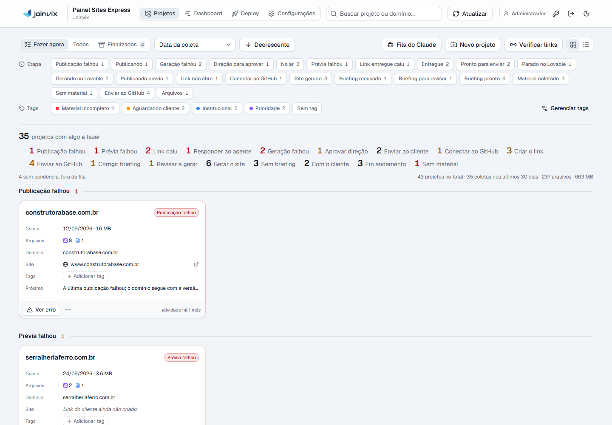
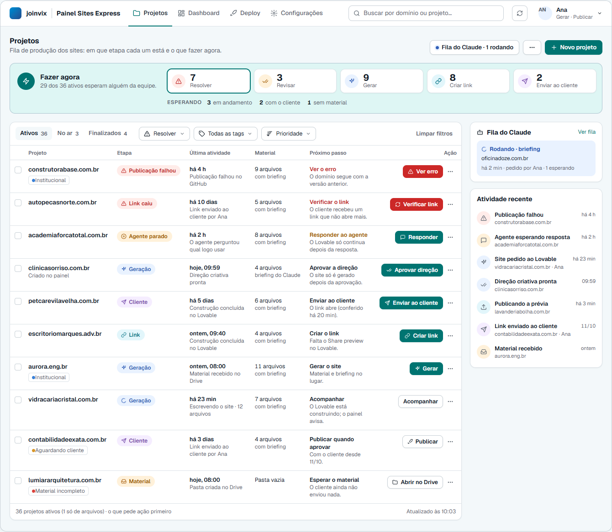
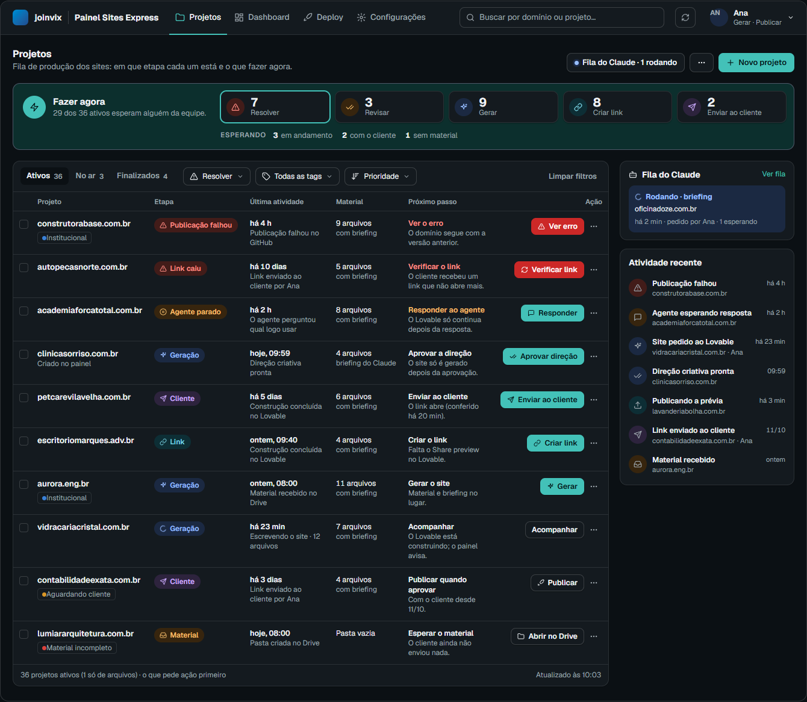
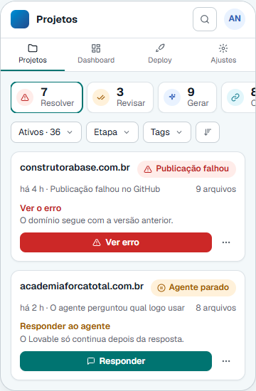
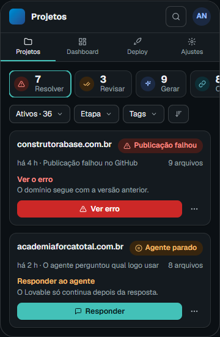
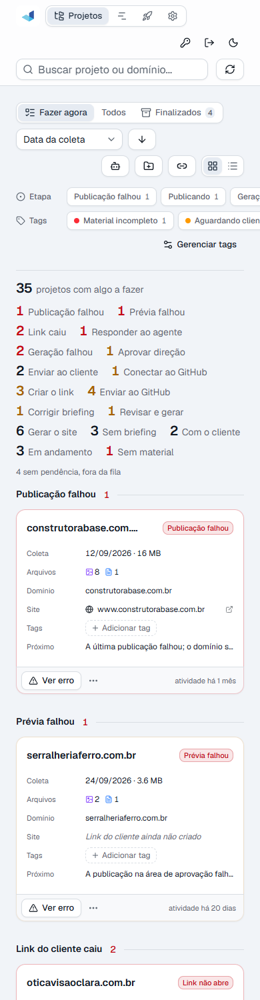
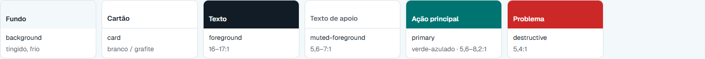
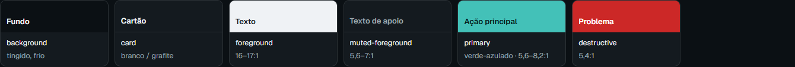
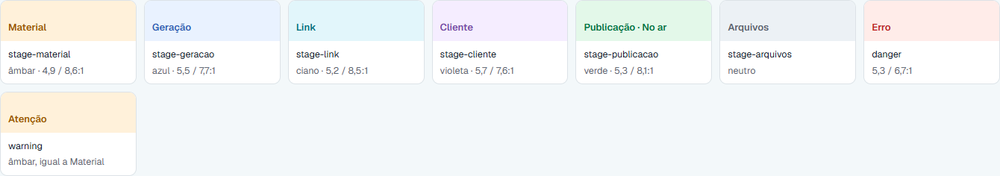
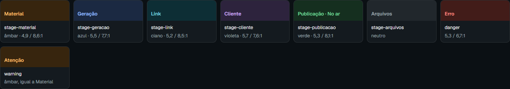

# Padronização do Painel Sites Express · Fase 1

Diagnóstico e proposta para aprovação · 14/10/2026

Percorri todas as telas numa instância isolada, nos dois temas e em 1440, 1024 e 390 px. Ela roda na porta 3334, com 43 projetos fictícios em todas as etapas e o motor Claude falso. Também conferi no código a origem de cada número. **Nada foi editado no código.** Este arquivo e as imagens ao lado são a única coisa nova na árvore. Espero a sua aprovação para seguir para as fases 2 e 3.

Sumário: [Resumo](#resumo) · [Para aprovar](#para-aprovar) · [Tela Projetos](#tela-projetos) · [Mapeamento de etapas](#mapeamento-de-etapas) · [Dados errados](#dados-errados-ou-incompletos) · [Paleta](#paleta-e-sistema) · [Inventário](#inventário-por-tela) · [O que sai](#o-que-sai-de-cada-tela) · [Componentes](#componentes) · [Em aberto](#em-aberto)

---

## Resumo

**O que mais pesa hoje**

- A tela Projetos mostra 27 textos de selo diferentes, 19 números no resumo e um grupo por etapa. A 1440 px, a fila "Fazer agora" tem 6.800 px de altura. No celular, o primeiro projeto só aparece depois de 760 px de controles.
- A "última atividade" é a data do arquivo no computador do cliente e ignora geração, envio e publicação. Um projeto cuja publicação falhou há 4 horas aparece com "atividade há 1 mês".
- O Dashboard conta "em aberto" e "pedem atenção" com regras diferentes da fila. Ele também dá como "aguardando geração" projetos que o Claude já está gerando.
- Há botões habilitados que o servidor recusa por falta de permissão. Os motivos de bloqueio ficam no `title` de botões desabilitados e nunca aparecem.

**O que proponho**

- Sete etapas visíveis (Material, Geração, Link, Cliente, Publicação, No ar, Arquivos) e oito selos de problema, todos lidos de uma fonte só.
- A tela Projetos como na imagem de referência:
  - faixa "Fazer agora" com 5 contadores de ação e 3 de espera;
  - filtros numa linha;
  - tabela com o próximo passo sempre visível e uma ação por linha;
  - coluna de atividade recente.
- Correção na origem dos dados errados: 2 no servidor, o resto na interface, com teste.
- Tokens novos: verde-azulado na ação principal, um tom por etapa e contraste AA nos dois temas. Por cima deles, um conjunto pequeno de componentes usado por todas as telas.

*Hoje: 25 selos de etapa no filtro, 19 números no resumo e um card por grupo.*

---

## Para aprovar

Cada item traz a minha recomendação. Se aprovar tudo, sigo até o fim sem novas paradas.

1. **Etapas.** Os 27 estados internos viram 7 etapas e 8 selos de problema. O selo diz onde o projeto está. Erro, agente parado, geração interrompida e link caído trocam o selo por um vermelho ou âmbar. A frase do próximo passo dá o detalhe. Veja o [mapeamento](#mapeamento-de-etapas).
2. **Fazer agora com uma faixa só.** Os 5 contadores de ação (Resolver, Revisar, Gerar, Criar link, Enviar ao cliente) e os 3 de espera (Em andamento, Com o cliente, Sem material) somam os projetos ativos. A segunda faixa da imagem (40/17/12/11) sai, porque responderia a mesma pergunta.
3. **Tabela como vista única.** A grade de cartões gasta seis linhas fixas por projeto para dizer menos do que uma linha da tabela.
   - A alternância grade/lista sai.
   - Abaixo de 900 px, a tabela vira cartões compactos.
   - A ordem padrão é por prioridade, com Resolver primeiro.
   - Não há paginação: são cerca de 40 projetos ativos.
4. **Paleta.** Verde-azulado na ação principal e um tom por etapa, sobre fundo levemente tingido, cartões brancos e bordas finas. Todos os pares de texto passam AA, de 4,9:1 a 17:1. O azul-marinho da marca fica no logotipo e no anel de foco. Veja a [paleta](#paleta-e-sistema).
5. **Duas correções no servidor, com teste.**
   - (a) A atividade do Drive passa a usar a data em que o arquivo **entrou** na pasta, e não a data do computador do cliente.
   - (b) Contar os arquivos das subpastas. Isso custa uma consulta ao Drive por subpasta, com o mesmo cache. **O item (b) depende do seu sim.**
6. **Permissões.** O que o servidor recusa fica desabilitado na tela, com o motivo escrito em texto e não em `title`. Nenhuma regra muda: a tela só passa a conferir a mesma permissão que o servidor já confere.

---

## Tela Projetos

A maquete usa os tokens propostos e os dados fictícios da instância de verificação. Os números da faixa são os reais dessa instância, já com o mapeamento proposto.

### Como a tela responde

- **Cabeçalho do app.** Traz o logo e o nome, as seções com ícone e sublinhado, e uma busca só. Na tela Projetos a busca filtra a lista; nas outras seções, leva para Projetos já filtrado. Ao lado, o botão de atualizar, com o horário no tooltip, e um menu de conta. Esse menu mostra o nome, o tipo de chave e as permissões, e dá acesso a "Chaves de acesso", ao tema e a "Sair".
- **Fazer agora.** Cada contador filtra a lista e fica marcado; um segundo clique desfaz. Com o filtro "Gerar" ligado, aparece "Gerar os 9 em lote".
- **Filtros numa linha:**
  - abas Ativos / No ar / Finalizados;
  - Etapa, com as 7 etapas e "Com problema";
  - Tags, com várias seleções, "qualquer" ou "todas", "sem tag" e "gerenciar";
  - Ordenar, com Prioridade, Última atividade, Coleta mais recente, Coleta mais antiga e Nome.
- **Cada linha:**
  - o domínio;
  - o nome do projeto, só quando é diferente do domínio;
  - as tags;
  - a última atividade, que é o evento mais recente de verdade, com o que aconteceu;
  - o material, com a contagem real e se há briefing;
  - o próximo passo (o quê e por quê), sempre visível;
  - uma ação, com o resto no menu "⋯". Quando há problema, o botão é vermelho.
- **Coluna lateral.** A Fila do Claude só aparece quando há algo nela. A atividade recente lista os últimos eventos de todos os projetos e abre o projeto ao clicar.

### Larguras

| Largura | Comportamento |
| --- | --- |
| 1440 | Como a maquete: tabela e coluna lateral lado a lado. |
| 1024 | A coluna lateral desce para baixo da tabela, e a coluna Material entra sob o nome do projeto. Nada rola de lado. |
| abaixo de 900 | Cada linha vira um cartão compacto, com a mesma informação na mesma ordem. Os contadores viram um trilho que rola de lado, e os filtros viram três botões. |
| 390 | A navegação fica em ícones com rótulo e a busca abre por um botão. O primeiro projeto aparece na primeira tela. |

| Celular, claro | Celular, escuro | Hoje, a 390 px |
| --- | --- | --- |
|  |  |  |

### Diálogos, no mesmo desenho

- **Cabeçalho.** Mostra o projeto, o selo e a frase do próximo passo. A ação principal aparece num lugar só. Hoje, "Enviar ao cliente" aparece duas vezes no diálogo do projeto, e o diálogo do Claude chega a três botões primários.
- **Corpo.** Tem rolagem própria e segue a ordem de leitura. O diálogo do projeto ganha a aba **Resumo**, com o link do cliente, a área de aprovação e a entrega. A aba Arquivos fica só com os arquivos, sem o bloco fixo que hoje ocupa quase toda a altura.
- **Rodapé.** Só tem ações: "Cancelar" contornado ao lado da ação principal. No briefing do Claude, "Gerar site" sai do fim de uma rolagem de seis telas e vai para o rodapé.
- **Detalhe técnico.** Comando do Claude, frase digitada, tabela de chamadas, workflows e secrets ficam num "Detalhes técnicos" recolhido.

---

## Mapeamento de etapas

Uma fonte só define, para cada estado: etapa, selo, ícone, tom, contador, próximo passo, ação e permissão. Selo, contadores, filtro, Dashboard e linha do tempo leem dali. Hoje esse papel está dividido entre `project-status`, `work-queue`, `next-step`, `stage-badge`, `phase-color` e `tone`.

| Estado interno (hoje) | Selo | Contador | Botão | Frase do próximo passo |
| --- | --- | --- | --- | --- |
| `empty` · Sem material | Material | Sem material (espera) | Abrir no Drive · contornado | A pasta está vazia: o cliente ainda não enviou o material. |
| `collected` · Material coletado | Geração | Gerar | Gerar | Sem o arquivo "Informações do Site": descreva o site ao gerar. |
| `briefed` · Briefing pronto | Geração | Gerar | Gerar | Material e briefing no lugar. |
| `claude-brief-ready` | Geração | Revisar | Revisar e gerar | O Claude escreveu o briefing e a conferência aceitou. |
| `claude-brief-refused` | Geração | Revisar | Corrigir briefing | A conferência apontou 2 pendências no briefing. |
| `claude-approval` | Geração | Revisar | Aprovar direção | A direção criativa está pronta; o site só é gerado depois da aprovação. |
| `claude-paused` | Geração | Revisar | Continuar | Parou antes da crítica da rodada 1 de 2. Continuar consome a assinatura. |
| `claude-queued` · `claude-briefing` · `claude-building` | Geração (girando) | Em andamento (espera) | Acompanhar · contornado | Na fila do Claude (2º) · Escrevendo o briefing · Em crítica, rodada 1 de 2… |
| `building` · Gerando no Lovable | Geração (girando) | Em andamento (espera) | Acompanhar · contornado | O Lovable está construindo o site; o painel avisa quando terminar. |
| `awaiting-input` · Parado no Lovable | **Agente parado** (âmbar) | Resolver | Responder | O agente perguntou: "…" (a pergunta lida pelo painel). |
| `claude-interrupted` | **Interrompida** (âmbar) | Resolver | Retomar ou descartar | Um reinício do painel interrompeu a execução. |
| `claude-failed` | **Geração falhou** (vermelho) | Resolver | Ver erro · vermelho | A geração falhou (ou terminou com a etapa aberta). Veja o erro antes de pedir de novo. |
| `generated` (Lovable, sem link) | Link | Criar link | Criar link | Falta o Share preview no Lovable. |
| `generated` (link não conferido) | Link | Criar link | Verificar link | O link foi colado e ainda não foi conferido. |
| `generated` (vinculado ou do Claude) | Link | Criar link | Publicar prévia | O código está no GitHub; publique a prévia para ter o link. |
| `to-github` | Link | Criar link | Enviar ao GitHub | O site está só nesta máquina; o link nasce depois do envio. |
| `to-github` com envio falho | **Envio falhou** (vermelho) | Resolver | Enviar ao GitHub | O envio ao GitHub falhou: (motivo). |
| `connect-github` | Link | Criar link | Conectar GitHub | Conecte o projeto ao GitHub no Lovable; o painel publica sozinho. |
| `dev-publishing` | Link (girando) | Em andamento (espera) | Acompanhar · contornado | Publicando a prévia: passo 7 de 13. |
| `dev-failed` | **Prévia falhou** (vermelho) | Resolver | Ver erro · vermelho | A publicação na área de aprovação falhou: (motivo do log). |
| `link-broken` | **Link não abre** (vermelho) | Resolver | Novo link / Verificar link · vermelho | O link ainda não foi enviado, mas não abre. |
| `ready` | Cliente | Enviar ao cliente | Enviar ao cliente | O link abre (conferido há 20 min). |
| `delivered` | Cliente | Com o cliente (espera) | Publicar · contornado | Com o cliente desde 11/10. Publique quando ele aprovar. |
| `delivered-broken` | **Link caiu** (vermelho) | Resolver | Verificar link / Novo link · vermelho | O cliente recebeu um link que não abre mais. |
| `deploying` | Publicação (girando) | Em andamento (espera) | Acompanhar · contornado | Publicando em www.dominio: passo 4 de 12. |
| `deploy-failed` | **Publicação falhou** (vermelho) | Resolver | Ver erro · vermelho | O domínio segue com a versão anterior (ou: o site não foi ao ar). |
| `live` | No ar | fora dos contadores (aba No ar) | Abrir site · contornado | No ar desde 08/10; última publicação há 2 dias. |
| `storage` | Arquivos | fora dos contadores (fim da aba Ativos) | Abrir arquivos · contornado | Projeto só de arquivos, criado no painel. |

Os textos de selo passam de 27 (fora os dinâmicos, como "Em crítica · rodada 1 de 2") para 15. São as 7 etapas mais 8 problemas: Agente parado, Interrompida, Geração falhou, Envio falhou, Prévia falhou, Link não abre, Link caiu e Publicação falhou.

**Regras do botão**

- **Preenchido (verde-azulado):** o passo depende de alguém da equipe agora.
- **Contornado:** quem precisa andar é o painel ou o cliente. Vale para acompanhar, esperar o material, publicar quando o cliente aprovar e abrir o site.
- **Vermelho:** o selo é um problema. "Ver erro" deixa de ser contornado na publicação e preenchido no Claude: passa a ser vermelho nos dois.
- **Sem permissão:** o botão fica desabilitado e a frase do próximo passo diz o motivo, por exemplo "Sua chave não pode publicar".

**Ordem de prioridade da lista.** A sequência é Resolver → Revisar → Enviar ao cliente → Criar link → Gerar → Em andamento → Com o cliente → Sem material → Arquivos. Dentro de cada grupo, o que está parado há mais tempo vem primeiro. Os grupos deixam de ter título na lista, porque os contadores fazem esse papel.

"Com o cliente" fica em espera, e não em "Fazer agora", porque a aprovação vem pelo WhatsApp e o painel não tem como saber dela.

---

## Dados errados ou incompletos

Conferi cada caso no código e na instância. Os de servidor mudam o que a API devolve e entram com teste; os demais são de cálculo ou de texto na interface.

### 1. "Última atividade" é a data do arquivo no computador do cliente

- **Onde:**
  - `server/src/drive.js:122` usa `modifiedTime`, e `routes/projects.js:169` repassa esse valor.
  - O próprio código avisa, em `drive.js:99`, que num upload essa é a data do computador do cliente. É por isso que ele já guarda `lastAdded` (o `createdTime`).
- **Efeito:**
  - uma coleta de hoje aparece com "atividade há 3 anos";
  - uma publicação que falhou há 4 h aparece com "atividade há 1 mês";
  - geração, envio, publicação e Claude não contam;
  - a ordenação "Última atividade" herda o erro.
- **Correção:**
  - No servidor, a atividade do Drive passa a ser o `createdTime` mais recente, ou seja, quando o arquivo entrou na pasta.
  - Na interface, uma função `lastEvent(project)` junta a linha do tempo, o Claude e o andamento. Ela alimenta a coluna, a ordenação e a atividade recente.
  - Testes nos dois lados.

### 2. Arquivos de subpastas não contam no Drive (e contam no painel)

- **Onde:** `drive.js:106` lê só os filhos diretos; `routes/local-projects.js:70` é recursivo.
- **Efeito:**
  - Uma coleta com tudo em subpastas aparece como "Pasta vazia" na grade e "0 arquivos · 2 subpastas" na tabela.
  - A tela de geração conta mais arquivos do que a lista.
- **Correção:** recomendo contar as subpastas no servidor, com uma consulta a mais por subpasta e o mesmo cache de 60 s. No mínimo, "Pasta vazia" só quando não há arquivo nem subpasta. **Em aberto.**

### 3. Dashboard conta "em aberto" e "pedem atenção" com outra regra

- **Onde:** `dashboard-metrics.ts:84, 204` contra `work-queue.ts:86`.
- **Efeito:**
  - Um projeto só de arquivos fica "em aberto, aguardando geração" para sempre.
  - Um site no ar cuja última publicação falhou some de "pedem atenção".
  - Na instância, "Pedem atenção 18" não bate com nenhum número da tela Projetos.
- **Correção:** as duas telas leem a mesma etapa. "Em aberto" passa a ser os Ativos, e "Pedem atenção" passa a ser Resolver + Revisar.

### 4. "Aguardando geração" inclui o que o Claude já está gerando

- **Onde:** `dashboard-metrics.ts:79`. A geração conta a partir de `generations[0].createdAt`, e o site do Claude só entra nessa lista quando é entregue.
- **Correção:** a geração começa quando o material vai para o Claude (`claude.material.copiedAt`), ou no clique em Gerar do Lovable. Vale para a fase, para as medianas e para o Gantt.

### 5. Duas datas de "no ar" para o mesmo projeto

- **Onde:** o Dashboard usa a primeira publicação. A linha do tempo diz "Site no ar" na última (`project-timeline.ts:245`) e mede "do recebimento à última publicação".
- **Correção:** "No ar desde" é a primeira publicação e "Última publicação" é a última, com esses nomes, nas duas telas.

### 6. Atividade recente perde eventos e não conhece o Claude

- **Efeito:**
  - Uma publicação que falhou ontem, num site no ar há 6 meses, não aparece no período de 30 nem no de 90 dias, porque o filtro é pelo período do projeto e não do evento.
  - Projetos no motor Claude só mostram "Projeto criado".
- **Correção:**
  - Filtrar pela data do evento.
  - Acrescentar à linha do tempo os marcos do Claude: material copiado, briefing aceito ou recusado, direção pronta, falha, site entregue e envio ao GitHub.

### 7. Erros mostrados como lista vazia

- **Efeito:** estas mensagens aparecem quando a leitura falhou:
  - "Nenhuma publicação ainda";
  - "Nenhuma execução ainda";
  - "0 repositórios na organização";
  - "0 arquivos · — em .github/workflows";
  - "workflow ainda não existe";
  - "Nenhuma tag criada", que também aparece durante a carga.
- **Correção:** um estado de erro com o motivo e "Tentar novamente", separado do estado vazio.

### 8. Publicações juntam a data de um envio com o autor de outro

- **Onde:** `publications-card.tsx:137-150`. "Último envio" vem de `lastDeployAt`, mas "por X" vem do último disparo, que pode ter sido uma simulação ou uma falha.
- **Correção:** mostrar o autor só quando o disparo é o mesmo envio; senão, sem autor.

### 9. Link do cliente com estado errado

- O selo diz "Não verificado" quando não existe link nenhum.
- A etapa "Conferindo…" fica girando sem nada em curso.
- "Pronto para enviar" continua aparecendo depois da entrega.

Arquivos: `client-link.tsx:126`, `dev-area-steps.ts:85-104`.

### 10. Gerar no Lovable fica ativo depois de gerar

- **Efeito:**
  - O servidor só barra uma geração simultânea ou de resultado incerto. Depois de um sucesso, um segundo clique passa pela confirmação e gera outro site, com outro débito.
  - A confirmação diz que é "a única ação que consome créditos", mas responder ao agente também consome.
- **Correção:**
  - Depois do sucesso, o rodapé vira "Abrir no Lovable" e "Fechar".
  - O texto da confirmação é corrigido.
  - A trava e a confirmação continuam iguais.

### 11. "Conferir" do briefing do Claude não confere o que vai rodar

- **Efeito:** confere o briefing gravado, sem as opções do rascunho. O resultado continua na tela depois de mudar o briefing ou as opções (`claude-briefing-card.tsx:153-164`).
- **Correção:** o ensaio usa as mesmas opções que o "Gerar site" mandaria e some quando algo muda. Continua sem disparar nada.

### 12. Permissões: a tela habilita o que o servidor recusa

Estes botões ficam habilitados para qualquer chave:

- "Salvar configuração" e "Limpar workflows", no Deploy;
- "Publicar agora", no diálogo de publicar;
- "Enviar ao cliente", "Verificar" e "Encurtar", no link do cliente;
- "Verificar links", na barra de seleção.

Quem não pode publicar digita a senha FTP e só então recebe 403. Além disso, os motivos de bloqueio do menu "⋯", da barra de seleção e de vários diálogos ficam num `title` que nunca aparece: item desabilitado não recebe o ponteiro.

### 13. Textos e números quebrados

- **Plurais e concordância:** "1 já têm site", "1 não foram publicados", "Chave válida · 1 modelos", "1 foto de banco conferidas".
- **Valores vazios ou inválidos:** "Copiar o conteúdo de “undefined”", "há NaN s" na fila do Claude, "etapa de etapa".
- **Números e datas:**
  - "US$ 0.42", com ponto decimal;
  - todas as execuções do dia aparecem como "hoje";
  - uma data inválida derruba a tela, porque `formatDate` lança erro.
- **Promessas sem dado:** "Parou em…" aparece sem a informação, porque `failedStep` não existe na API.
- **Suposições e textos fixos:**
  - "Pasta remota … (padrão)" supõe a convenção de uma hospedagem específica;
  - "localhost:3333" está fixo na mensagem de erro de conexão;
  - a conclusão do GitHub aparece em inglês ("action_required").

### 14. Contagens e estados que divergem entre telas

- "N no total · N coletas nos últimos 30 dias" conta finalizados e projetos do painel. Há três definições diferentes de "30 dias" no painel.
- Tags: o seletor mostra o número gravado no banco, que inclui pastas que saíram do Drive; o filtro mostra o número real.
- "Configurado", nas Configurações, só olha os segredos. O GitHub com token e sem organização aparece como configurado.
- O selo "configurado" do seletor de repositórios vem do armazenamento do navegador, não do servidor.
- O diálogo do projeto mostra duas datas para a mesma coisa: "Coletado em" (do nome da pasta) e "Recebido em" (da criação da pasta).

---

## Paleta e sistema

Os tokens vão para `web/src/index.css`, nos temas claro e escuro.

| Superfícies e ação (claro) | Superfícies e ação (escuro) |
| --- | --- |
|  |  |

| Um tom por etapa (claro) | Um tom por etapa (escuro) |
| --- | --- |
|  |  |

### Valores (OKLCH) e contraste

Contraste do texto sobre o fundo do selo ou da superfície. O mínimo AA é 4,5:1.

| Token | Claro | Escuro | Contraste claro / escuro |
| --- | --- | --- | --- |
| Fundo da página | `0.975 0.006 230` | `0.17 0.012 240` | — |
| Cartão | `1 0 0` | `0.215 0.014 240` | — |
| Texto | `0.22 0.025 250` | `0.96 0.005 240` | 17,3 / 17,0 |
| Texto de apoio | `0.50 0.02 250` | `0.72 0.015 240` | 6,0 / 7,1 |
| Ação principal (verde-azulado) | `0.50 0.095 192`, texto branco | `0.74 0.11 188`, texto escuro | 5,6 / 8,2 |
| Problema (botão) | `0.55 0.2 27`, texto branco | igual | 5,4 / 5,4 |
| Etapa Material (âmbar) | texto `0.53 0.13 60` sobre `0.965 0.035 75` | `0.83 0.12 75` sobre `0.28 0.045 70` | 4,9 / 8,6 |
| Etapa Geração (azul) | `0.50 0.15 262` sobre `0.96 0.025 262` | `0.80 0.11 262` sobre `0.28 0.05 262` | 5,5 / 7,7 |
| Etapa Link (ciano) | `0.50 0.09 215` sobre `0.96 0.022 215` | `0.82 0.09 210` sobre `0.28 0.04 215` | 5,2 / 8,5 |
| Etapa Cliente (violeta) | `0.50 0.15 302` sobre `0.96 0.03 302` | `0.80 0.12 302` sobre `0.28 0.05 302` | 5,7 / 7,6 |
| Etapa Publicação e No ar (verde) | `0.49 0.12 155` sobre `0.96 0.03 155` | `0.80 0.13 155` sobre `0.28 0.045 155` | 5,3 / 8,1 |
| Erro | `0.52 0.19 27` sobre `0.96 0.025 27` | `0.78 0.15 25` sobre `0.28 0.06 25` | 5,3 / 6,7 |

Os tons de estado (sucesso, atenção, info e erro) continuam separados dos tons de etapa. O tom de atenção é o mesmo âmbar de Material, e o de info reaproveita o azul da Geração.

### Tipografia (Geist, já instalada)

| Papel | Tamanho / altura · peso | Exemplo |
| --- | --- | --- |
| Título de página | 24/32 · 650 | Projetos |
| Título de seção | 16/24 · 650 | Atividade recente |
| Corpo | 14/20 · 400 | Material e briefing no lugar. |
| Pequeno | 13/18 · 500 | Rótulo de botão e de campo |
| Legenda | 12/16 · 400 | há 4 h · Publicação falhou |
| Número | 20/24 · 650, tabular | 7 |

### Espaço, raio, regras

- **Espaço** em degraus de 4 px: 4 · 8 · 12 · 16 · 24 · 32.
  - Margem da página: 24 px, ou 16 no celular.
  - Entre blocos: 18 px.
  - Dentro do cartão: 12 px no compacto, 16 a 20 no normal.
- **Raio:** cartão 12 px, controle 8 px, tag 5 px; o selo de etapa é uma pílula.
- **Ações:** uma ação primária por contexto (página, linha, diálogo). Botões e ícones só nos tamanhos das variantes.
- **Datas:** relativa até 7 dias ("há 4 h", "ontem, 09:40") e absoluta depois ("11/10", ou "11/10/2025" se for de outro ano), com a data completa no tooltip. Uma função só.
- **Dado ausente:** vira "—" num campo, ou some. Nunca aparece no meio de uma frase.
- **Plurais:** sempre por `pluralize()`.
- **Texto truncado:** sempre com o valor inteiro acessível, no tooltip e para o leitor de tela.

---

## Inventário por tela

Cada linha segue a ordem: informação exibida → pergunta que ela responde → origem do dado → veredito. Listo só o que muda ou o que pesa; o que fica como está não aparece item por item.

Vereditos: **manter** · **rebaixar** (para detalhe, tooltip ou menu) · **remover** · **corrigir** (errado, incompleto, duplicado ou só visível no hover).

### Projetos (fila, todos, finalizados, grade e lista, filtros, seleção)

| Informação | Pergunta | Origem | Veredito |
| --- | --- | --- | --- |
| Selo de etapa (27 textos, mais "Em crítica · rodada 1 de 2") | Em que pé está? | `projectStatus` | **corrigir**: 7 etapas + 8 problemas |
| Frase da etapa ("Próximo", cortada em uma linha; na lista, 2 linhas) | O que falta? | `status.detail` | **manter**: sempre inteira, coluna própria |
| Filtro de etapa: 25 chips em 3 fileiras | Quais estão em X? | `countStages` | **rebaixar**: seletor com 7 etapas + "Com problema" |
| Resumo: total, 19 números e "N sem pendência" | O que faço agora? | `groupByNextStep` | **corrigir**: 5 de ação + 3 de espera |
| "43 no total · 35 coletas em 30 dias · 237 arquivos · 663 MB" | Quanto há no Drive? | `summarize()` | **remover**: não leva a decisão e mistura bases |
| Títulos de grupo (19) e faixas de data (Hoje, Ontem…) | — | `work-queue`, `date-groups` | **remover**: ordem por prioridade + contadores |
| Campo "Domínio" no cartão (repete o título) | Qual o domínio? | `projectIdentity` | **remover** |
| "Coleta dd/mm · 16 MB" e ícones de tipo de arquivo | Quanto material? | nome da pasta, `kinds` | **rebaixar**: "9 arquivos · com briefing", tamanho no tooltip |
| "Site": link do cliente ou domínio | Onde vejo o site? | `clientUrlOf`, publicação | **rebaixar**: menu "⋯" e diálogo |
| "atividade há X" / coluna Datas | Quando mexeram nele? | `lastActivity` (Drive) | **corrigir**: último evento real + o que foi |
| Botão do passo + menu "⋯" (até 13 itens, um separador) | O que faço com ele? | `nextStep` | **corrigir**: "Ver erro" sempre vermelho; menu em grupos (Site, Projeto, Abrir em…) |
| Ordenação: 6 critérios + direção | Em que ordem? | `sortProjects` | **rebaixar**: 5 opções num seletor, sem direção |
| Grade × lista | — | — | **remover**: tabela, e cartões abaixo de 900 px |
| Fila do Claude, Novo projeto, Verificar links | — | — | **manter**: Fila no cabeçalho e na coluna lateral; Verificar links no "⋯" da página |
| Barra de seleção: 9 botões contornados | O que faço com os marcados? | seleção | **corrigir**: motivos visíveis, plurais, permissão |
| "Dados sincronizados em…" (hora da resposta, não do Drive) | Isto está atual? | `fetchedAt` | **rebaixar**: "Atualizado às 10:03" no botão de atualizar |

### Diálogo do projeto (arquivos, link do cliente, linha do tempo)

| Informação | Pergunta | Origem | Veredito |
| --- | --- | --- | --- |
| Título, selo, frase da etapa, andamento | Onde está e por quê? | `projectStatus` | **manter** |
| Selo "Coletado em" (nome da pasta) × "Recebido em" (criação da pasta) | Quando chegou? | duas fontes | **corrigir**: uma data só |
| Bloco do link do cliente fixo sobre a lista (até 6 partes) | O link abre? Já foi? | `client-link.tsx` | **corrigir**: vai para a aba Resumo |
| "Enviar ao cliente" no cabeçalho e no bloco; "Publicar na área" em 4 lugares | — | — | **remover** as duplicatas |
| Selo "Não verificado" sem link; "Conferindo…" parado; "pronto para enviar" depois de entregue | O link vale? | `previewState`, `dev-area-steps` | **corrigir** |
| Detalhe da sonda, assinatura Joinvix, captura | Por que não abre? | `previewDetail` | **rebaixar**: "Detalhes" recolhido |
| Barra de arquivos: 9 controles | Como acho um arquivo? | — | **rebaixar**: ordenação num menu |
| Cartão de arquivo "— · 12/10/2026 10:00" (Google Docs) | Tamanho e data | Drive | **corrigir**: só a data |
| Linha do tempo: resumo, eventos, "responsável não registrado" | Como chegou aqui? | `projectTimeline` | **manter**, com os eventos do Claude e o motivo visível |
| Pré-visualização: setas que somem, ações coladas ao X, `setState` durante o render | — | — | **corrigir** |

### Geração (Lovable, rápida, em lote)

| Informação | Pergunta | Origem | Veredito |
| --- | --- | --- | --- |
| Faixa "O que vai no envio" (briefing, contato, fotos, logo, assinatura) | O material basta? | `assessBriefing` | **manter**, com a dica só na lista e não no `title` |
| Selo "Lovable desconectado" + Alert de conexão + "Desconectar" no cabeçalho | Dá para gerar? | `useLovableConnection` | **remover** o selo; "Desconectar" vai para Configurações |
| Contador de caracteres e anexos em 3 a 5 lugares | Quanto vai? | resumo do envio | **rebaixar**: um só, no rodapé |
| Resultado com id do projeto e JSON cru | Deu certo? | resposta da API | **rebaixar**: "Abrir no Lovable" |
| "Gerar site" ativo depois de gerar; texto "única ação que consome créditos" | — | — | **corrigir** |
| Lote: projeto bloqueado pintado de vermelho; "use Revisar" sem botão Revisar | Quem fica de fora? | `quick-generate.ts` | **corrigir**: âmbar e texto certo |

### Motor Claude (briefing, fila, sequência, log, site entregue, GitHub)

| Informação | Pergunta | Origem | Veredito |
| --- | --- | --- | --- |
| Briefing: selo, conferência, avisos, editor | Está pronto? O que corrigir? | `review` | **manter** |
| Opções do site: 6 seletores com ajuda fixa, chaves, skills, referências, notas | Com que parâmetros sai? | `review.opcoes` | **rebaixar**: modelo e esforço à vista, o resto recolhido |
| "Gerar site" no fim de 6 telas de rolagem | — | — | **corrigir**: rodapé fixo |
| Frase digitada ao Claude e comando CLI | O que vai rodar? | `plan` | **rebaixar**: "Detalhes técnicos" |
| Até 3 primárias (aprovar, gerar outro do zero, enviar ao GitHub) | — | — | **corrigir**: uma primária, as outras secundárias |
| Tabela de etapas ("chamadas X de Y", builds) e detalhes de execução (8 itens, id do modelo, US$) | O que já rodou? | `site.etapas`, `runs` | **rebaixar**: histórico técnico; ficam a duração e quem pediu |
| Motivo da falha de uma etapa só no `title` | Por que falhou? | `motivoFalha` | **corrigir**: visível |
| Fila: "Cancelar" × "Cancelar execução"; posição calculada de dois jeitos; "há NaN s" | O que roda e o que espera? | `status.queue` | **corrigir** |
| Banco de imagens no fluxo do Claude com regras do Lovable ("zip conta como anexo") | — | `stock-images-section` | **corrigir** |
| Aviso "geração desligada" em 5 versões e "fila pausada" repetido em cada projeto | Dá para gastar? | `generation` | **corrigir**: um componente, um texto |
| `material.skipped`, tarefa local em curso, mensagem da última execução | O que ficou de fora? Já está validando? | API, nunca exibido | **corrigir**: mostrar |

### Deploy (sem configuração, sem repositório, configurado, em edição)

| Informação | Pergunta | Origem | Veredito |
| --- | --- | --- | --- |
| Seletor com sugestão e motivo | Qual repositório é deste site? | publicações + nome do Lovable | **manter** |
| Selo "configurado" no seletor | Já foi configurado? | armazenamento do navegador | **corrigir**: vem do servidor |
| Branch, privado, "atualizado há X" | — | GitHub | **rebaixar**: tooltip |
| Resumo "Publicação configurada" + Publicar | Posso publicar? | `publication.settings` | **manter** como caminho comum; corrigir a pasta "(padrão)" |
| Formulário em edição com "Publicar agora" ao lado (2 primárias) | — | — | **corrigir**: uma por vez |
| Simular (dry-run) no cartão principal | — | — | **rebaixar**: opção secundária |
| Cartão de workflows, secrets gravados, "Limpar workflows" | O que há no repositório? | GitHub | **rebaixar**: "Detalhes técnicos" |
| Aviso de workflows antigos em 3 lugares, com instruções diferentes | — | — | **remover** as duplicatas |
| Execuções: "Parou em…" nunca preenchido; conclusão em inglês; tudo "hoje" | Deu certo? | Actions | **corrigir** |
| Publicações: estado em texto e em selo na mesma linha | O que está no ar? | publicações | **rebaixar** o texto; corrigir o autor |

### Dashboard

| Informação | Pergunta | Origem | Veredito |
| --- | --- | --- | --- |
| Em aberto (e "aguardando geração") | Quanto trabalho há? | `!closed` | **corrigir**: igual aos Ativos da tela Projetos |
| Pedem atenção | Quanto está travado? | `status.attention` | **corrigir**: Resolver + Revisar, com link para o filtro |
| Recebidos / Foram ao ar no período | Estamos dando conta? | `createdTime`, primeira publicação | **manter**, com um rótulo que diz o que mede |
| Medianas: espera até a geração, tempo até o ar | Onde demora? | datas da linha | **corrigir**: início da geração do Claude; sites vinculados fora da mediana |
| Por etapa (4 fases próprias) | Onde estão? | `phase` | **corrigir**: as mesmas 7 etapas do selo |
| Por desenvolvedor | Quem está com o quê? | `createdBy` | **manter** |
| Linha do tempo dos projetos (Gantt) | Quanto cada um levou? | `segmentsOf` | **manter**, com as cores das etapas |
| Atividade recente | O que aconteceu? | `recentActivity` | **remover**: vai para a tela Projetos |

### Configurações e acesso

| Informação | Pergunta | Origem | Veredito |
| --- | --- | --- | --- |
| 9 seções numa página de 5.400 px; estado só nas seções com segredo | O que está ligado? | `sectionStatus` | **corrigir**: visão geral das integrações no topo; o estado considera os campos obrigatórios |
| Nome da variável `.env` sob cada rótulo | Onde isso fica? | schema | **rebaixar**: menor, ao lado da ajuda |
| "Não salvo" em 3 lugares; "reinicie" em 3 | — | — | **remover** as duplicatas |
| Motores na seção Geração repetindo a seção Claude | — | — | **rebaixar**: uma linha com link |
| Teste do GitHub sem a validade do token (`tokenExpiresAt`) | Até quando funciona? | API, nunca exibido | **corrigir**: mostrar |
| Erro sem "Tentar novamente"; "Cancelar" fantasma no campo de segredo | — | — | **corrigir** |
| Identidade: nome escondido abaixo de 1280 px; tipo de chave e permissões só no `title` | Com que chave estou? | `/api/me` | **corrigir**: menu de conta |
| Erro de conexão com "localhost:3333" fixo e sem tentar de novo | O painel está de pé? | — | **corrigir** |
| Chaves de acesso: lista sem rolagem; explicação das permissões só no `title` | Quem pode o quê? | `access-keys` | **corrigir** |

---

## O que sai de cada tela

**Projetos**

- Alternância grade/lista e o cartão de 6 campos fixos.
- Filtro de etapa em 25 chips, resumo de 19 números, títulos de grupo e faixas de data.
- A linha "N no total · coletas em 30 dias · arquivos · MB".
- Campo "Domínio" repetido, ícones de tipo, botão de direção e as ordenações por volume, nº de arquivos e nº de tags.
- "Dados sincronizados em" no rodapé, que vai para o tooltip do botão de atualizar.

**Diálogo do projeto**

- O segundo "Enviar ao cliente" e o segundo "Verificar".
- "Publicar na área" repetido: fica no menu e no bloco da área.
- O selo "Coletado em".
- O bloco fixo do link sobre a lista, que vira a aba Resumo.
- "Linha do tempo" no menu do próprio diálogo, que já é uma aba.

**Geração e motor Claude**

- Selo de conexão duplicado e "Desconectar" no cabeçalho.
- Contadores repetidos; id e JSON do resultado.
- Primárias concorrentes; descrições de diálogo com três frases.
- Frase interna e comando à vista, que vão para "Detalhes técnicos".

**Deploy, Dashboard e Configurações**

- Deploy:
  - "Parou em…", que nunca tem o dado;
  - avisos de workflow repetidos;
  - estado repetido nas publicações.
- Dashboard:
  - atividade recente, que vai para Projetos;
  - fases próprias, trocadas pelas etapas.
- Configurações:
  - selo "Não salvo" e aviso de reinício repetidos;
  - toast de reinício.

---

## Componentes

Todos sobre o shadcn/Radix que já existe. Nenhuma dependência nova.

**Criar**

- `stage.ts`: a fonte única (estado → etapa, selo, ícone, tom, contador, passo, ação, permissão), com testes.
- `AppHeader` com menu de conta e `PageHeader`.
- `CounterCard` e a faixa `WorkNow`; `FilterBar` e um `MultiSelect` de tags.
- `DataTable`, com cabeçalho, linha, linha selecionada, estados vazio, carregando e erro, e a versão em cartões no celular.
- `StageBadge`, `NextStep` (texto, botão e motivo) e `ActivityFeed`.
- `SectionCard`, `OptionCard`, `ChoiceCard` e um `Field` só, para Deploy, Configurações e diálogos.
- Diálogo padrão (`DialogShell`: cabeçalho, corpo com rolagem e rodapé com Cancelar + ação principal) e `DisabledReason`, para o motivo em texto.
- `format.ts`:
  - `formatWhen`, relativa até 7 dias;
  - `formatBytes` no formato pt-BR;
  - datas que não lançam erro;
  - testes.

**Remover ou fundir**

- `project-card.tsx`, `date-groups.ts`, `work-summary.tsx`, `stage-filter.tsx`, `filter-chip.tsx` e `phase-color.ts`.
- As 3 cópias de `HintWhenDisabled`, as 2 paletas de tag e o segmentado feito à mão das tags.
- Receitas soltas:
  - faixas de aviso fora do `Alert`;
  - caixas tracejadas;
  - spinner feito à mão;
  - cartões-checkbox repetidos (6);
  - listas emolduradas repetidas (4).
- `stageClass`, `queueToneClass` e os mapas de rótulo paralelos do Claude.

---

## Em aberto

Decisões que dependem de você, com a minha recomendação primeiro.

1. **Contar os arquivos das subpastas no servidor?** **Sim.** Custa uma consulta a mais por subpasta, com o cache de 60 s (6 h nos finalizados). Sem isso, a lista continua dizendo menos do que a tela de geração.
2. **Recoletas herdam o "No ar" do mesmo domínio.** **Manter o selo**, porque é o mesmo site do cliente. No Dashboard, o domínio passa a contar uma vez só: hoje "Foram ao ar" conta duas vezes.
3. **Projeto do painel do tipo "site" sem site cai em "Enviar ao GitHub"**, mesmo quando tem material para o Claude. **Recomendo** "Gerar com o Claude" quando há arquivos e nenhum site detectado. Isso precisa de um campo novo na lista (`hasSite`), com teste.
4. **Nome da seção "Deploy".** **Manter "Deploy"**: essa decisão já estava em aberto na auditoria anterior. As ações dentro da seção continuam "Publicar".
5. **Identidade no cabeçalho.** A chave não informa cargo. **Mostro** o nome e, embaixo, o tipo ("Chave do administrador") ou as permissões ("Gerar · Publicar").
6. **Quando reiniciar o painel.** A interface nova só passa a valer quando o lançador reconstruir a interface, na próxima subida. As correções de servidor também só valem depois do reinício. **Não rodo** `npm run build` nem `npm run check`. Verifico com `lint`, `typecheck` e `test`, e aviso no fim para combinarmos o reinício.

---

### Sobre este arquivo

Esta pasta (`docs/proposta-padronizacao/`) é o material da Fase 1 e não está commitada. Quando o trabalho terminar, o registro definitivo vai para uma seção nova de `docs/AUDITORIA-UI.md` e para um `DESIGN.md`, como você pediu. Esta pasta pode então ser apagada. As imagens vêm da instância isolada, com domínios fictícios.
